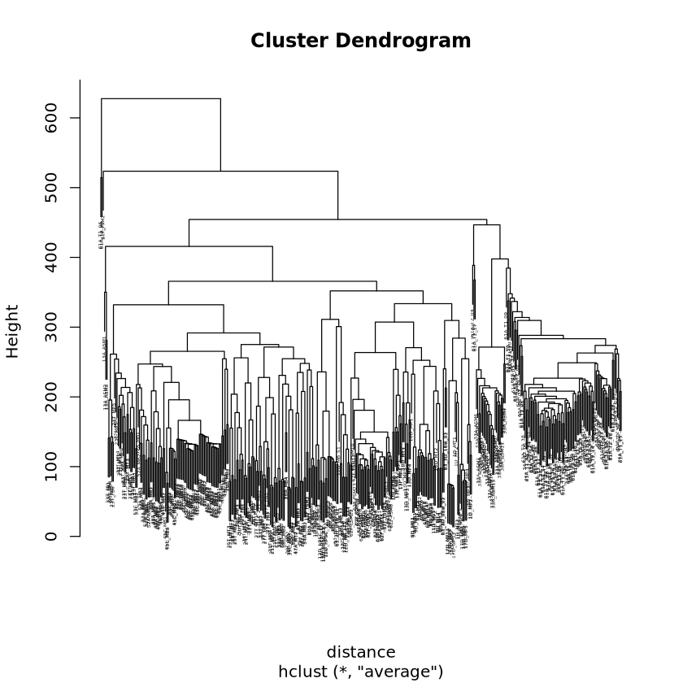

### This notebook contains the code for creating correlation matrices between groups

```R
library(tidyverse)
library(edgeR)
library(matrixStats)
library(cowplot)
library(DESeq2)
library(scales)
library(readr)
library(PCAtools)
library(plotly)
library(ggfortify)
library(tidyverse)
library(limma)
library(RColorBrewer)
library(gplots)
library(corrplot)


counts = "/staging/leuven/stg_00134/GENERAL/rawdata/STARoutput/Ranalysis/Comparisons/allFC.counts.NOV.tsv"
counts <- as.matrix(read.csv(counts, sep="\t", row.names="X"))
colnames(counts) <- sub("^X", "", colnames(counts)) #to remove the Xs in the column names (this happens bc the column names start with a number)
dim(counts)
head(counts)


deg <- DGEList(counts)
deg.norm <- calcNormFactors(deg, method="TMM")
cpmALLsamples <- cpm(deg.norm)
cpmALLsamples.df <- as.data.frame(cpmALLsamples)

cpmALLsamples.df <- tibble::rownames_to_column(cpmALLsamples.df, var = "geneID")
head(cpmALLsamples.df)

#Sig PW genes
SPW <- c("NOTCH2", "RBPJL", "NOTCH3", "NOTCH1", "MAML1", "NOTCH4", "PSEN1", "RBPJ", "DLL3", "LFNG", "DLL4", "FUT8", "NCSTN", "POFUT1", "CIR1", "JAG2", "JAG1", "FBXW7", "ADAM10", "DLK1", "NCOR2", "ADAM17", "MFNG", "NUMB", "CDKN1A", "MAML2", "KDM1A", "ENO1", "YY1", "CCND1", "MYC", "DNER", "EP300", "SKP2", "BTRC", "SKP1", "PSENEN", "PTCRA", "DNM1", "NCOR1", "ADAM12", "MYCBP", "HDAC1", "CTBP1", "CUL1", "FURIN", "GATA3", "DLL1", "APH1A", "APH1B", "RBBP8", "EPS15", "MARK2", "SPEN", "CNTN6", "RAB11A", "MIB1", "MFAP5", "IL4", "ITCH", "NEURL1", "MFAP2", "CNTN1", "LNX1", "APP", "GSK3B", "FHL1", "SIN3A", "HEY2", "MAGEA1", "AKT1", "JAK2", "HES6", "MEF2C", "RING1", "RBX1", "SAP30", "KAT2B", "LCK", "MAML3", "NUMBL", "HDAC2", "LEF1", "PSEN2", "DTX1", "PIK3R2", "PIK3R1", "ASCL1", "BLOC1S1", "MAPK1", "HES1", "HES5", "MAPK3", "SMAD1", "SMAD3", "STAT3", "WDR12", "NFKB1", "SNW1", "NLK", "NKD1", "LRP6", "FRAT1", "WIF1", "DVL1", "WNT1", "MAP3K7", "FZD1", "JUN", "CREBBP", "TLE1", "CSNK2A1", "FBXW11", "CSNK1A1", "AXIN1", "PPP2R5D", "FOS", "HNF1A", "KREMEN2", "DKK1", "DKK2", "APC", "CTNNB1", "TAB1", "PPARD", "EGLN1", "HSP90AA1", "EGLN3", "EGLN2", "NAA10", "CDKN2A", "CUL2", "ARNT", "HIF3A", "HIF1A", "COPS5", "OS9", "RACK1", "ELOB", "VHL", "ELOC", "HIF1AN", "TP53", "PRKN", "GPR37", "PTEN", "RORC", "TPTE", "GPR37L1", "MTOR", "AKT2", "AKT3", "TACE", "DNAJC6", "EPN1", "STAT5A", "STAT5B", "PIAS3", "STAT1", "STAT3", "MAPK14", "PIAS2", "PIAS1", "PTPRC", "SOCS1", "STAT4", "STAT6", "JAK2", "JAK3", "JAK1", "CNTFR", "CSF3", "CSF2", "CSF3R", "EPO", "MPL", "IL5RA", "IL1RAP", "TNF", "LEPR", "TNFSF10", "IL12B", "IL12A", "IL13RA2", "IL6R", "IL13RA1", "IFNAR2", "IL15RA", "IFNA13", "IFNA14", "IL4R", "IFNA16", "IL1R1", "IFNA17", "IL1R2", "LIFR", "PRLR", "TXLNA", "IL6ST", "IFNAR1", "IFNA10", "CSF2RB", "CSF2RA", "THPO", "IFNA21", "LIF", "IFNW1", "IL4", "IL3", "IL6", "IL5", "IFNG", "IFNGR1", "IFNGR2", "IL10", "IL10RB", "IL10RA", "TYK2", "SOCS2", "MAPK9", "SOCS3", "MAPK8", "MAPK1", "SOCS6", "SOCS7", "SOCS4", "MAPK3", "SOCS5", "PIAS4", "CISH", "MAPK15", "MAPK12", "IFNA5", "IFNA4", "IFNA7", "IFNA6", "IFNA1", "IFNA2", "IFNA8", "USP18", "PTPN1", "IFNB1", "STAT2", "PTPN11", "PTPN6", "NRAS", "ARAF", "KRAS", "BRAF", "GRB2", "RAF1", "SOS1", "SOS2", "HRAS", "IRF9", "COL12A1", "ARPC5L", "ACTB", "MYLK", "PREX1", "AKT2", "PRKACG", "AKT3", "PLCE1", "AKT1", "PRKACA", "PRKACB", "JUNB", "PRKCB", "PRKCE", "FPR1", "FPR3", "PRKCZ", "GNG10", "RRAS", "PLCG2", "PLCG1", "CCR10", "CCR1", "MYH7B", "JUN", "XCR1", "JUND", "NFATC3", "NFATC2", "NFATC1", "GNG12", "NFATC4", "GRAP", "ARPC1B", "ARPC1A", "CX3CL1", "IKBKB", "CCR9", "RAC2", "CCR8", "CCR7", "CCR6", "RAC1", "CCR5", "CCR4", "PF4V1", "CCR3", "CCR2", "RHOG", "RHOC", "RHOA", "VAV1", "PLCB3", "PLCB4", "PLCB1", "PLCB2", "CCL13", "CCL11", "GNAI3", "CXCR5", "CXCR4", "ADCY2", "PRKX", "CXCR6", "PTGS2", "ADCY6", "GNAI1", "ADCY5", "PTGS1", "GNAI2", "PAK1", "BLK", "HCK", "YES1", "FGR", "LYN", "FRK", "SHB", "FYN", "SRC", "AGTR1", "ERBB2", "VEGFR1", "IL28A", "IL11RA", "IL23R", "IL7RA", "KIT", "TPO-R", "PPP2CB", "M-CSFR", "ERBB4", "VEGFR3", "IGF1R", "IL12RB1", "IL20RB", "IL2RA", "IL9R", "NTRK2", "CSFR3", "PAR1", "GHR", "IL12RB2", "IL21", "IL2RB", "INSR", "OSMR", "PTAFR", "FGF1", "IL15", "IL21R", "IL32", "VEGFR2", "MERTK", "PDGFRA", "TIE-2", "BRCA1", "IKBKE", "RORC", "CAMK2B", "ERK1", "SH2B1", "CAMK2G", "ERK2", "JNK1", "STIP1", "FOS", "MAPK11", "PRKCD","CTHRC1","DKK1","DKK2","FRZB","IGFBP4","RSPO1","RSPO2","RSPO3","SFRP1","SFRP2","SFRP4","SOST","WIF1","WNT1","WNT10B","WNT11","WNT16","WNT2","WNT3","WNT3A","WNT5A","WNT5B","WNT6","WNT7A","WNT7B","WNT8A","WNT8B","WNT9A","WNT9B","ADAM10","APH1A","APH1B","ATP6AP2","CAMK2A","CAV1","CDH1","CDH2","CHRNA7","CSNK1E","CSNK1G1","DLL1","FZD1","FZD10","FZD2","FZD3","FZD4","FZD5","FZD6","FZD7","FZD8","FZD9","GPC3","GSK3B","KREMEN1","KREMEN2","LRP1","LRP5","LRP6","MAP3K1","MYC","NCSTN","NOTCH1","PORCN","PSEN1","PSENEN","ROR1","ROR2","RYK","SETDB1","TMED5","WLS","KL","WNT10A","WNT2B","WNT4","FGFR1a", "KLB", "CTNND1", "FGF1", "CDH2", "CDH1", "PLAU", "RPS6KA1", "AKT1", "PDPK1", "HGF", "GAB1", "PLAUR", "FRS2", "FOS", "MMP9", "DUSP6", "RUNX2", "CTTN", "PIK3CA", "SOS1", "MET", "SDC4", "SRC", "SHC1", "SDC2", "CAMK2A", "PIK3R1", "PSEN1", "CBL", "BGLAP", "SPP1", "MAPK1", "PTK2B", "NCAM1", "PLCG1", "FGF23", "MAPK3", "KL", "STAT5B", "JUN", "STAT1", "STAT3", "GZMB", "PTPN11", "SSH1", "FGF19", "SPRY2", "GRB2", "FGFR4", "FGFR3", "FGFR2", "FGFR1b", "ARAF", "PEBP1", "PPP2R2A", "FGF3", "FGF4", "FGF5", "FGF6", "FGF7", "FGF8", "FGF9", "PPP2R1B", "PPP2R1A", "AKT2", "AKT3", "MAP3K6", "MAP3K4", "MAP3K5", "PRKCG", "MAP2K3", "MAP2K4", "PRKCI", "MAP2K1", "PRKCH", "MAP2K2", "PRKCB", "PRKCE", "PRKCD", "PRKCA", "FRS3", "PRKCQ", "RAF1", "SHC3", "PRKCZ", "PLCG2", "FGF20", "SFN", "MAP2K7", "FGF22", "MAP2K6", "FGF17", "FGF14", "FGF18", "GRAP", "FGF13", "FGF12", "FGF11", "FGF10", "YWHAE", "YWHAB", "PIK3CD", "PIK3CB", "PIK3C2A", "BRAF", "ELK1", "FGF2", "FGF16", "FGFRL1", "SPRED2", "SPRED1", "NRAS", "FGFR5", "TSG14", "HRAS", "FGF21", "A2M", "A2ML1", "CNPY2", "FGFBP1", "FGFBP2", "FGFBP3", "LRIT3", "PTX3", "SHISA4", "SPRY1", "SPRY3","SH3KBP1", "INPPL1", "PTPRJ", "WASL", "ETS1", "CRKL", "RPTOR", "DEPTOR", "CDH1", "AKT2", "MLST8", "NCK2", "AKT1", "RAC1", "HRAS", "SH3GL2", "NCK1", "MAP2K4", "PRKCI", "MAP2K1", "MAP2K2", "PDPK1", "HGF", "GAB1", "GAB2", "RHOA", "PIK3CA", "HGS", "AKT1S1", "NUMB", "RAPGEF1", "ARHGEF4", "RAF1", "SOS1", "MET", "CRK1", "RIN2", "KPNB1", "ARF6", "SRC", "SHC1", "PXN", "PIK3R1", "CBL", "PRKCZ", "RAP1B", "CDC42", "MAPK8", "PAK1", "PARD6A", "RAP1A", "INPP5D", "CTNNA1", "EIF4EBP1", "MAPK1", "PLCG1", "PAK2", "EIF4E", "EPS15", "MAPK3", "PAK4", "PTPN1", "EGR1", "JUN", "MAP3K1", "BAD", "RANBP9", "PTPN11", "MTOR", "PTK2", "APC", "SNAI1", "RANBP10", "CTNNB1", "GRB2", "MUC20", "RAB5A", "BCAR1", "PTPN2", "F2RL2", "SHC2", "SHC3", "PIK3CD", "PIK3CB", "NRAS", "PLCG2", "RAC2", "RAC3", "KRAS", "SOS2", "DOCK1", "ELK1", "ITGB1", "LAMA5", "LAMB3", "LAMA2", "LAMC3", "LAMB2", "ITGA3", "LAMA1", "ITGA2", "LAMA4", "LAMA3", "LAMC2", "LAMB1", "LAMC1", "STAT3", "DOCK7", "COL11A1", "COL11A2", "SDCBP", "CCL5", "BSG", "PRKACA", "FGF23", "TGFB1", "MMP7", "MMP1", "CASK", "MMP9", "COL1A1", "COL3A1", "COL2A1", "COL1A2", "COL4A2", "COL5A1", "COL4A1", "COL6A2", "COL4A4", "FGF19", "COL7A1", "COL6A1", "COL4A3", "COL5A2", "COL4A6", "SDC1", "COL6A3", "COL4A5", "COL6A6", "COL6A5", "HPSE", "PPIB", "FGFR4", "FGFR3", "FGFR2", "CYFIP2", "NCKAP1", "ROCK1", "CTNND1", "AQP5", "AQP3", "LPP", "EGFR", "IGF1R", "LIMA1", "MYO6", "MGAT3", "STX4", "PIP5K1C", "GIT1", "CD44", "EZR", "ITGB4", "CRK2", "SHP2", "SHP1", "HPN", "ST14", "MSP", "FAS", "SEMA4D","YAP1", "YWHAE", "WWTR1", "YWHAB", "WWC1", "STK4", "AMOT", "SAV1", "STK3", "TJP1", "MOB1B", "LATS1", "MOB1A", "LATS2", "CASP3", "DVL2", "AMOTL2", "NPHP4", "AMOTL1", "TJP2", "TEAD4", "GATA4", "TBX5", "HIPK1", "RUNX2", "HIPK2", "KAT2B", "NPPA", "NKX2-5", "TEAD1", "TEAD2", "TEAD3", "RUNX3", "AP-1", "CTNNB1", "WTS", "MATS", "TAO-1")
cpmALLsamples.df <- cpmALLsamples.df %>%
  filter(geneID %in% SPW)

cpmALLsamples.df


DMT_cols <- c("1D_MT1","1D_MT2","1D_MT3","1D_MT4","6D_MP13","6D_MP14","6D_MP15","6D_MP16","6D_MP17","6D_MP18","6D_MT1","6D_MT2","6D_MT3","6D_MT4","6D_MT5","6D_MT6","9D_MT1","9D_MT2","9D_MT3","9D_MT4","10D_MT1","10D_MT2","12D_MB_L1","12D_MB_L2","12D_MB_S1","12D_MP_L13","12D_MP_L14")
TMT_cols <- c("23T_MT1","23T_MT3","23T_MT4","23T_MT5","23T_MT6","24T_MT1", "24T_MT2","24T_MT3", "25T_MT1","25T_MT2","25T_MT3","25T_MT4","27T_MT1","27T_MT2","27T_MT3")
MF_cols <- c("34A_T1_01","34A_T1_02", "34A_T1_03", "34A_T1_04", "34A_T1_05","34A_T1_06","34A_T1_07","34A_T1_08","34A_T1_09","34A_T2_01","34A_T2_02","34A_T2_03","34A_T2_04","34A_T2_05","34A_T2_06","34A_T2_07","34A_T2_08","34A_T2_09","61A_T1_01","61A_T1_02","61A_T1_03","61A_T1_04","61A_T1_05","61A_T1_06","61A_T1_07","61A_T1_08","61A_T1_09","61A_T1_10","61A_T1_11","61A_T1_12","61A_T1_13","61A_T1_14","61A_T1_15","61A_T1_16","61A_T1_17","61A_T1_18","61A_T1_19","61A_T1_20","61A_T1_21","61A_T1_22","61A_T1_23","61A_T1_24","61A_T1_25","61A_T1_26","61A_T1_27","61A_T1_28","61A_T1_29","61A_T1_30","61A_T1_31","61A_T1_32","61A_T1_33","61A_T1_34","61A_T1_35","61A_T1_36","61A_T1_37","61A_T1_38","61A_T1_39","61A_T2_01","61A_T2_02","61A_T2_03","61A_T2_04","61A_T2_05","61A_T2_06","61A_T2_07","61A_T2_08","61A_T2_09","61A_T2_10","61A_T2_11","61A_T2_12","61A_T2_13","61A_T2_14","61A_T2_15","61A_T2_16","61A_T2_17","61A_T2_18","61A_T2_19","61A_T2_20","61A_T2_21","61A_T2_22","61A_T2_23","61A_T2_24","61A_T2_25","61A_T2_26","61A_T2_27","61A_T2_28","61A_T2_29","61A_T2_30","61A_T2_31","61A_T2_32","61A_T2_33","61A_T2_34","61A_T2_35","61A_T2_36","61A_T2_37","61A_T2_38","61A_T2_39","61A_T2_40","61A_T2_41")
FMT_cols <- c("62F_FSM10","62F_FSM11","62F_FSM12","62F_FSM13","62F_FSM14","62F_FSM15","62F_FSM16","62F_FSM17","62F_FSM18","62F_FSM19","62F_FSM1","62F_FSM20","62F_FSM21","62F_FSM22","62F_FSM23","62F_FSM24","62F_FSM25","62F_FSM26","62F_FSM27","62F_FSM28","62F_FSM29","62F_FSM2","62F_FSM30","62F_FSM31","62F_FSM32","62F_FSM33","62F_FSM34","62F_FSM35","62F_FSM3","62F_FSM4","62F_FSM5","62F_FSM6","62F_FSM7","62F_FSM8","62F_FSM9")

DMP_cols <- c("1D_MP1","1D_MP2","1D_MP3","1D_MP4","9D_MP1","9D_MP2","9D_MP3","9D_MP4","10D_MP1","10D_MP2","12D_MP_L9","12D_MP_L10","12D_MP_L11","12D_MP_L12","13D_MP1","13D_MP2","13D_MP3","13D_MP4","13D_MP5","17D_MP1","17D_MP10","17D_MP11","17D_MP12","17D_MP2","17D_MP3","17D_MP4","17D_MP5","17D_MP6","17D_MP7","17D_MP8","17D_MP9","15D_MP1","15D_MP2","15D_MP3")
TMP_cols <- c("22T_MB1","22T_MB2","22T_MB3","23T_MB1","23T_MB2","23T_MB3","23T_MB4","23T_MB5","23T_MB6","26T_MB1","26T_MB2","26T_MB3","27T_MB1","27T_MB2","27T_MB3")
AMP_cols <- c("13A_ASM1","13A_ASM2","13A_ASM3")
FMP_cols <- c("10F_FSM3","10F_FSM4","13F_MP1","13F_MP2","13F_MP3")

hPSC_cols <- c("1D_hPSC1","1D_hPSC2","1D_hPSC3","1D_hPSC4","6D_hPSC1","6D_hPSC2","6D_hPSC3","6D_hPSC4","6D_hPSC5","6D_hPSC6","12D_hPSC_L1","12D_hPSC_L2","12D_hPSC_S1","12D_hPSC_S2","12D_hPSC_T1","12D_hPSC_T2")
FB_cols <- c("20T_FB1","20T_FB2","20T_FB3","21T_FB1","21T_FB2","21T_FB3","23T_FB1","23T_FB2","23T_FB4","23T_FB5","23T_FB6","24T_FB1","24T_FB2","24T_FB3","25T_FB1","25T_FB2","27T_FB1","27T_FB2","27T_FB3","27T_FB4","27T_FB5","27T_FB6")
E_cols <- c("13E_MP1","13E_MP2","13E_MP3")
CMB_cols <- c("43C_MB1","43C_MB2","39C_MB1","39C_MB2","39C_MB3","41C_MB1","41C_MB2","45C_MB1","45C_MB2","45C_MB3","45C_MB4","45C_MB5","45C_MB6","45C_MB7","45C_MB8","45C_MB9","45C_MB10","45C_MB11","45C_MB12","45C_MB13","45C_MB14","45C_MB15","45C_MB16","45C_MB17","45C_MB18","45C_MB19","45C_MB20","45C_MB21","45C_MB22","45C_MB23","45C_MB24","45C_MB25","45C_MB26","45C_MB27","45C_MB28","45C_MB29","45C_MB30","45C_MB31","45C_MB32","45C_MB33","45C_MB34","45C_MB35","45C_MB36","45C_MB37","45C_MB38","45C_MB39","45C_MB40","45C_MB41","45C_MB42","45C_MB43","45C_MB44","45C_MB45","53C_MB1","53C_MB2","55C_MB1","55C_MB2","55C_MB3","58C_MB1","58C_MB2","58C_MB3")
CMT_cols <- c("40C_MT1","40C_MT2")

cols_vectors <- ls(pattern = "_cols$")

total_length <- sum(sapply(cols_vectors, function(x) {
  obj <- get(x)
  if (is.vector(obj)) length(obj) else 0
}))

total_length

median <- cpmALLsamples.df %>%
  rowwise() %>%
  mutate(
    median_DMT = median(c_across(all_of(DMT_cols))),
    median_TMT = median(c_across(all_of(TMT_cols))),
    median_MF = median(c_across(all_of(MF_cols))),
    median_FMT = median(c_across(all_of(FMT_cols))),
    median_DMP = median(c_across(all_of(DMP_cols))),
    median_TMP = median(c_across(all_of(TMP_cols))),
    median_AMP = median(c_across(all_of(AMP_cols))),
    median_FMP = median(c_across(all_of(FMP_cols))),
    median_hPSC = median(c_across(all_of(hPSC_cols))),
    median_FB = median(c_across(all_of(FB_cols))),
    median_E = median(c_across(all_of(E_cols))),
    median_CMB = median(c_across(all_of(CMB_cols))),
    median_CMT = median(c_across(all_of(CMT_cols))),  
  )
dim(median)
head(median)

median2 <- median[, c(1, (ncol(median) - 12):ncol(median))]
dim(median2)
head(median2)

mediancpm <- column_to_rownames(median2, var="geneID")

cor_matrix <- cor(mediancpm, method = "pearson", use = "pairwise.complete.obs")

corrplot(cor_matrix, method = "color", type = "upper", 
         tl.col = "black", tl.srt = 45,
         addCoef.col = "black", number.cex = 0.7)
```  

    
```R
corrplot(cor_matrix, method = "color", order = "hclust", addCoef.col = "black")

``` 

    
```R
corrplot(cor_matrix, method = "color", order="hclust", type = "upper", 
         tl.col = "black", tl.srt = 45,
         addCoef.col = "black", number.cex = 0.7)
```   

    
```R
pdf("/staging/leuven/stg_00134/Margaux/corrplotSPW.pdf", width = 7, height = 7)
corrplot(cor_matrix, method = "color", order="hclust", type = "upper", 
         tl.col = "black", tl.srt = 45,
         addCoef.col = "black", number.cex = 0.7)
dev.off()

corr <- round(cor(mediancpm), 2)
head(corr)
p.mat <- cor_pmat(mediancpm)

ggcorrplot(corr)
```
  


```R
ggcorrplot(corr, hc.order = TRUE, outline.col = "white")
```    

    
```R
ggcorrplot(corr, hc.order = TRUE, outline.col = "white", lab = TRUE)
```    

    
```R
ggcorrplot(corr, hc.order = TRUE, type = "lower", lab = TRUE)
```   

    
```R
mean <- cpmALLsamples.df %>%
  rowwise() %>%
  mutate(
    mean_DMT = mean(c_across(all_of(DMT_cols))),
    mean_TMT = mean(c_across(all_of(TMT_cols))),
    mean_MF = mean(c_across(all_of(MF_cols))),
    mean_FMT = mean(c_across(all_of(FMT_cols))),
    mean_DMP = mean(c_across(all_of(DMP_cols))),
    mean_TMP = mean(c_across(all_of(TMP_cols))),
    mean_AMP = mean(c_across(all_of(AMP_cols))),
    mean_FMP = mean(c_across(all_of(FMP_cols))),
    
    mean_hPSC = mean(c_across(all_of(hPSC_cols))),
    mean_FB = mean(c_across(all_of(FB_cols))),
    mean_E = mean(c_across(all_of(E_cols))),
    mean_CMB = mean(c_across(all_of(CMB_cols))),
    mean_CMT = mean(c_across(all_of(CMT_cols)))
  )

mean <- cbind(rownames = rownames(cpmALLsamples.df), mean)
mean <- mean[, c(1, (ncol(mean) - 12):ncol(mean))]
dim(mean)
head(mean)

meancpm <- column_to_rownames(mean, var="rownames")

corr <- round(cor(meancpm), 2)

ggcorrplot(corr, hc.order = TRUE, outline.col = "white")
```
    

    

```R
F_male_cols <- c("62F_FSM10","62F_FSM24","62F_FSM3","62F_FSM7","62F_FSM9","62F_FSM12","62F_FSM21","62F_FSM30","62F_FSM32","62F_FSM6","62F_FSM20","62F_FSM5","62F_FSM13","62F_FSM31","62F_FSM2","62F_FSM11","62F_FSM25","62F_FSM8","62F_FSM18","62F_FSM34","62F_FSM4","62F_FSM14","62F_FSM26")
F_female_cols <- c("62F_FSM19","62F_FSM29","62F_FSM17","62F_FSM28","62F_FSM15","62F_FSM27","62F_FSM35","62F_FSM1","62F_FSM22","62F_FSM33","62F_FSM16","62F_FSM23")

F_week12_cols <- c("62F_FSM19","62F_FSM29")
F_week13_cols <- c("62F_FSM10","62F_FSM24","62F_FSM3","62F_FSM7","62F_FSM9","62F_FSM12","62F_FSM21","62F_FSM30","62F_FSM32","62F_FSM6","62F_FSM20")
F_week14_cols <- c("62F_FSM17","62F_FSM28","62F_FSM5","62F_FSM13","62F_FSM31")
F_week15_cols <- c("62F_FSM2","62F_FSM11","62F_FSM15","62F_FSM25","62F_FSM27","62F_FSM35")
F_week16_cols <- c("62F_FSM1","62F_FSM8","62F_FSM22","62F_FSM33")
F_week17_cols <- c("62F_FSM16","62F_FSM18","62F_FSM23","62F_FSM34")
F_week18_cols <- c("62F_FSM4","62F_FSM14","62F_FSM26")


subset4 <- cpmALLsamples.df %>%
  rowwise() %>%
  mutate(
    median_F_week12 = median(c_across(all_of(F_week12_cols))),
    median_F_week13 = median(c_across(all_of(F_week13_cols))),
    median_F_week14 = median(c_across(all_of(F_week14_cols))),
    median_F_week15 = median(c_across(all_of(F_week15_cols))),
    median_F_week16 = median(c_across(all_of(F_week16_cols))),
    median_F_week17 = median(c_across(all_of(F_week17_cols))),
    median_F_week18 = median(c_across(all_of(F_week18_cols)))  
  )
dim(subset4)
head(subset4)


subset5 <- subset4[, c(1, (ncol(subset4) - 6):ncol(subset4))]
dim(subset5)
head(subset5)

mediancpm <- column_to_rownames(subset5, var="geneID")

corr <- round(cor(mediancpm), 2)

ggcorrplot(corr, hc.order = TRUE, outline.col = "white", lab = TRUE)
``` 

    
```R
subset4 <- cpmALLsamples.df %>%
  rowwise() %>%
  mutate(
    median_F_male = median(c_across(all_of(F_male_cols))),
    median_F_female = median(c_across(all_of(F_female_cols)))
  )

subset5 <- subset4[, c(1, (ncol(subset4) - 1):ncol(subset4))]
head(subset5)

mediancpm <- column_to_rownames(subset5, var="geneID")
corr <- round(cor(mediancpm), 2)
ggcorrplot(corr, hc.order = TRUE, outline.col = "white", lab = TRUE)
```
    

  
```R
F_arm_upperlimb_cols <- c("62F_FSM19","62F_FSM10","62F_FSM12","62F_FSM21","62F_FSM20","62F_FSM17","62F_FSM13","62F_FSM11","62F_FSM15","62F_FSM35","62F_FSM16","62F_FSM18","62F_FSM14")
F_leg_lowerlimb_cols <- c("62F_FSM3","62F_FSM7","62F_FSM9","62F_FSM6","62F_FSM5","62F_FSM2","62F_FSM1","62F_FSM8","62F_FSM34","62F_FSM4")
F_back_trunck_cols <- c("62F_FSM29","62F_FSM24","62F_FSM30","62F_FSM32","62F_FSM28","62F_FSM31","62F_FSM25","62F_FSM27","62F_FSM22","62F_FSM33","62F_FSM23","62F_FSM26")

subset4 <- cpmALLsamples.df %>%
  rowwise() %>%
  mutate(
    median_F_arm_upperlimb = median(c_across(all_of(F_arm_upperlimb_cols))),
    median_F_leg_lowerlimb = median(c_across(all_of(F_leg_lowerlimb_cols))),
    median_F_back_trunck = median(c_across(all_of(F_back_trunck_cols)))
  )
dim(subset4)
head(subset4)

subset5 <- subset4[, c(1, (ncol(subset4) - 2):ncol(subset4))]
head(subset5)

mediancpm <- column_to_rownames(subset5, var="geneID")
corr <- round(cor(mediancpm), 2)
ggcorrplot(corr, hc.order = TRUE, outline.col = "white", lab = TRUE)
``` 

    

